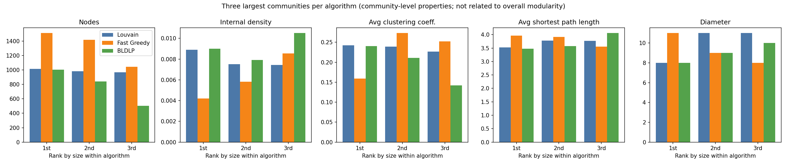

# Community detection comparison: LastFM Asia

All figures below are read from the saved result files of the actual runs.

## Summary

| algorithm | num_communities | overall_modularity | execution_time_seconds | largest_community_size | smallest_community_size | average_community_size | random_seed | converged |
|---|---|---|---|---|---|---|---|---|
| Louvain | 24 | 0.8159 | 0.06079 | 1016 | 4 | 317.7 | 42 |  |
| Fast_Greedy | 44 | 0.7966 | 0.3291 | 1512 | 3 | 173.3 |  |  |
| BLDLP | 376 | 0.7627 | 377.5 | 1006 | 2 | 20.28 | 42 | False |

BLDLP convergence: converged = **False** after 10000 iterations (max_iter = 10000). Seed 42; a single run only, so BLDLP's result is one sample of a randomised process.

## Partition similarity

Community IDs are arbitrary labels: ID 0 in one algorithm has no relation to ID 0 in another, so IDs are never compared. Similarity is measured on the partitions themselves with the Adjusted Rand Index (1 = identical, ~0 = chance) and Normalized Mutual Information (0-1).

| algorithm_a | algorithm_b | ARI | NMI |
|---|---|---|---|
| Louvain | Fast_Greedy | 0.7074 | 0.7988 |
| Louvain | BLDLP | 0.5927 | 0.7122 |
| Fast_Greedy | BLDLP | 0.4606 | 0.667 |

## Three largest communities of each algorithm

Properties are per community (induced subgraph). Where a community is disconnected, path length and diameter are computed on its largest connected component (see `path_metrics_scope`). These are not shares of the overall modularity, which is a single number for the whole partition.

| algorithm | rank | num_nodes | internal_edges | internal_density | avg_clustering_coefficient | avg_shortest_path_length | diameter | is_connected | path_metrics_scope |
|---|---|---|---|---|---|---|---|---|---|
| Louvain | 1 | 1016 | 4586 | 0.008894 | 0.2426 | 3.524 | 8 | True | whole community |
| Louvain | 2 | 983 | 3629 | 0.007519 | 0.2392 | 3.774 | 11 | True | whole community |
| Louvain | 3 | 969 | 3482 | 0.007424 | 0.2265 | 3.766 | 11 | True | whole community |
| Fast_Greedy | 1 | 1512 | 4804 | 0.004205 | 0.1592 | 3.966 | 11 | True | whole community |
| Fast_Greedy | 2 | 1420 | 5874 | 0.00583 | 0.2731 | 3.914 | 9 | True | whole community |
| Fast_Greedy | 3 | 1046 | 4674 | 0.008552 | 0.2521 | 3.559 | 8 | True | whole community |
| BLDLP | 1 | 1006 | 4549 | 0.008999 | 0.2406 | 3.481 | 8 | True | whole community |
| BLDLP | 2 | 840 | 2787 | 0.007909 | 0.2109 | 3.573 | 9 | True | whole community |
| BLDLP | 3 | 503 | 1326 | 0.0105 | 0.1423 | 4.058 | 10 | True | whole community |

## Charts

- comparison_modularity.png
- comparison_community_counts.png
- comparison_execution_time.png
- comparison_community_sizes.png

## Interpretation and trade-offs

- **Modularity is not a universal ranking.** Louvain and Fast Greedy explicitly optimise modularity (Louvain by local moving plus aggregation, Fast Greedy by greedy pairwise merging), so a high score is expected for them. BLDLP is a label-propagation method that does not optimise modularity; a lower score does not by itself mean a worse partition for other purposes.
- Modularity also has a known resolution limit, and different community counts reflect different granularity, not necessarily different quality.
- Execution times measure only the algorithm core (BLDLP includes edge-weight computation); BLDLP is a pure-Python implementation while Louvain and Fast Greedy use compiled igraph code, so the timing gap partly reflects implementation, not just algorithmic complexity.
- Louvain and BLDLP are randomised (seeded); Fast Greedy is deterministic. Other seeds could give different partitions; only one seed was run.
- No ground-truth communities exist here. The dataset's country-derived target labels are available but were not used as ground truth in these comparisons.
